<a href="https://kav-portfolio-chi.vercel.app">
  <picture>
    <source media="(prefers-color-scheme: dark)" srcset="assets/neofetch-dark.svg">
    <source media="(prefers-color-scheme: light)" srcset="assets/neofetch-light.svg">
    
  </picture>
</a>

```console
$ ls -l ~/projects
```

| project | lang | what it does |
|---|---|---|
| **[whosup](https://github.com/kav-sw19/whosup)** | Rust | `top` for your coding agents: every session you have running, what each one is doing, and whether it needs you.<br>`brew install kav-sw19/tap/whosup` |
| **[KavOS](https://github.com/kav-sw19/kav-portfolio)** | TypeScript | A portfolio that boots like an old PC: a terminal, a Win95 desktop and a LaTeX-style CV. **[Boot it ↗](https://kav-portfolio-chi.vercel.app)** |
| **[sundial](https://github.com/kav-sw19/sundial)** | JavaScript | One honest photo a day: a one-shot-a-day camera PWA that seals your year into a film. |

**[Portfolio](https://kav-portfolio-chi.vercel.app)** · **[CV](https://kav-portfolio-chi.vercel.app/#plain)** · **[LinkedIn](https://linkedin.com/in/kav.sw19)** · **[kav.sw19@gmail.com](mailto:kav.sw19@gmail.com)**

<sub>The neofetch card is a hand-made SVG. Try <code>ls -a</code> on <a href="https://kav-portfolio-chi.vercel.app">the portfolio</a>.</sub>
