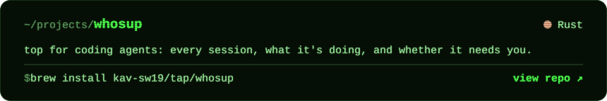
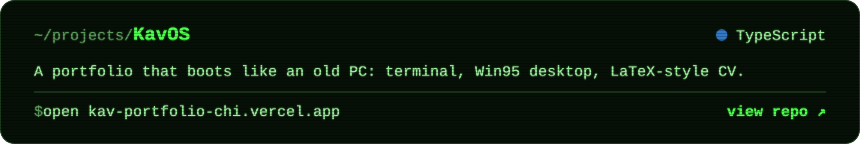
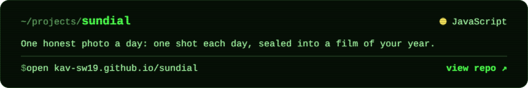
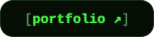
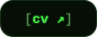
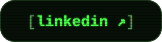
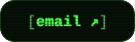

<a href="https://kav-portfolio-chi.vercel.app">
  <picture>
    <source media="(prefers-color-scheme: dark)" srcset="assets/neofetch-dark.svg">
    <source media="(prefers-color-scheme: light)" srcset="assets/neofetch-light.svg">
    
  </picture>
</a>

<a href="https://github.com/kav-sw19/whosup"><picture><source media="(prefers-color-scheme: dark)" srcset="assets/project-whosup-dark.svg"><source media="(prefers-color-scheme: light)" srcset="assets/project-whosup-light.svg"></picture></a>

<a href="https://github.com/kav-sw19/kav-portfolio"><picture><source media="(prefers-color-scheme: dark)" srcset="assets/project-kavos-dark.svg"><source media="(prefers-color-scheme: light)" srcset="assets/project-kavos-light.svg"></picture></a>

<a href="https://github.com/kav-sw19/sundial"><picture><source media="(prefers-color-scheme: dark)" srcset="assets/project-sundial-dark.svg"><source media="(prefers-color-scheme: light)" srcset="assets/project-sundial-light.svg"></picture></a>

  <a href="https://kav-portfolio-chi.vercel.app"><picture><source media="(prefers-color-scheme: dark)" srcset="assets/link-portfolio-dark.svg"><source media="(prefers-color-scheme: light)" srcset="assets/link-portfolio-light.svg"></picture></a>
  <a href="https://kav-portfolio-chi.vercel.app/#plain"><picture><source media="(prefers-color-scheme: dark)" srcset="assets/link-cv-dark.svg"><source media="(prefers-color-scheme: light)" srcset="assets/link-cv-light.svg"></picture></a>
  <a href="https://linkedin.com/in/kav.sw19"><picture><source media="(prefers-color-scheme: dark)" srcset="assets/link-linkedin-dark.svg"><source media="(prefers-color-scheme: light)" srcset="assets/link-linkedin-light.svg"></picture></a>
  <a href="mailto:kav.sw19@gmail.com"><picture><source media="(prefers-color-scheme: dark)" srcset="assets/link-email-dark.svg"><source media="(prefers-color-scheme: light)" srcset="assets/link-email-light.svg"></picture></a>

